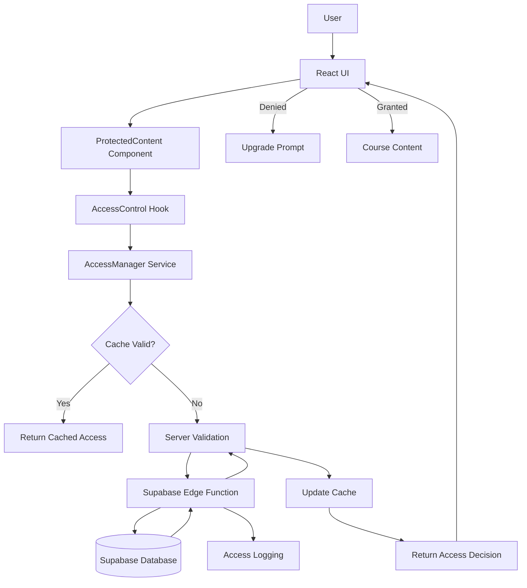

# Course Access Control Architecture

## Executive Summary

This document provides a comprehensive architectural overview of the course access control system for the AI for Elders platform. The system implements multi-layered security with both client-side and server-side validation to ensure paid content is properly protected.

## System Architecture

### High-Level Data Flow



## Core Components

### 1. AccessManager Service (`src/lib/accessControl.ts`)

**Purpose**: Central service for all access validation logic

**Key Features**:
- Singleton pattern for consistent state management
- Multi-level caching with TTL
- Rate limiting (100 requests/minute per user)
- Suspicious activity detection
- Batch validation support

**Key Methods**:
```typescript
validateAccess(request: AccessRequest): Promise<AccessResponse>
validateContentAccess(userId: string, gate: ContentGate): Promise<AccessResponse>
validateBatchAccess(userId: string, resources: Array): Promise<Map>
clearUserCache(userId: string): void
```

### 2. Server-Side Validation (`supabase/functions/validate-access`)

**Purpose**: Authoritative access validation at the server level

**Security Features**:
- JWT token validation
- Direct database queries with service role
- IP tracking for audit trails
- Comprehensive error logging
- Grace period handling

**Response Format**:
```typescript
{
  granted: boolean,
  reason?: 'authenticated' | 'tier_mismatch' | 'expired' | 'locked',
  userTier?: string,
  upgradeRequired?: string,
  message?: string
}
```

### 3. ProtectedContent Component (`src/components/ProtectedContent.tsx`)

**Purpose**: UI wrapper for content protection

**Features**:
- Loading states during validation
- Graceful fallbacks
- Upgrade prompts
- Error handling
- Skeleton loading

**Usage**:
```tsx
<ProtectedContent 
  courseId="ai-assistant"
  requiredTier="advanced"
  enforceServerSide={true}
>
  <CourseContent />
</ProtectedContent>
```

### 4. Database Schema

#### Access Attempts Table
```sql
access_attempts (
  id: uuid
  user_id: uuid
  resource_type: text
  resource_id: text
  required_tier: text
  user_tier: text
  access_granted: boolean
  denial_reason: text
  ip_address: text
  user_agent: text
  suspicious: boolean
  timestamp: timestamptz
)
```

#### Content Access Rules Table
```sql
content_access_rules (
  id: uuid
  content_type: text
  content_id: text
  required_tier: text
  is_active: boolean
  override_rules: jsonb
)
```

#### Subscription Access Cache Table
```sql
subscription_access_cache (
  id: uuid
  user_id: uuid
  resource_key: text
  has_access: boolean
  validated_at: timestamptz
  expires_at: timestamptz
)
```

## Security Layers

### Layer 1: Client-Side Validation
- Immediate feedback
- Reduces server load
- Never trusted as authoritative

### Layer 2: Server-Side Validation
- JWT verification
- Database subscription check
- Tier hierarchy validation
- Grace period handling

### Layer 3: Access Logging
- All attempts logged
- Suspicious pattern detection
- Security event generation
- Audit trail maintenance

### Layer 4: Rate Limiting
- Per-user request limits
- Exponential backoff
- IP-based throttling

## Integration Points

### 1. Authentication Context
```typescript
const { user } = useAuth();
// User object contains id, email, tier
```

### 2. Subscription Hook
```typescript
const { subscription, canAccessTier } = useSubscription();
// Quick client-side tier checking
```

### 3. Access Control Hook
```typescript
const { checkAccess, handleAccessDenied } = useAccessControl();
// Comprehensive access validation
```

### 4. Access Control Context
```typescript
const { validateAccess, invalidateCache } = useAccessControlContext();
// Global access state management
```

## Implementation Guidelines

### For Course Pages
```typescript
// In CoursesPage.tsx
const handleCourseAccess = async (courseId: string, tier: Tier) => {
  if (!user) {
    onAuthClick();
    return;
  }
  
  const access = await accessManager.validateContentAccess(user.id, {
    courseId,
    requiredTier: tier,
    enforceServerSide: true
  });
  
  if (!access.granted) {
    toast.error('Upgrade Required', {
      description: access.message
    });
    return;
  }
  
  // Navigate to course
  setSelectedCourse(courseId);
};
```

### For Module Content
```typescript
// In ModulePage.tsx
<ProtectedContent
  courseId={courseId}
  moduleId={moduleId}
  requiredTier={getCourseTier(courseId)}
  onUpgradeClick={() => navigateToUpgrade()}
>
  <ModuleContent />
</ProtectedContent>
```

### For Batch Validation
```typescript
// Check access to multiple courses
const courses = [
  { id: 'ai-basics', tier: 'free' },
  { id: 'ai-assistant', tier: 'advanced' },
  { id: 'advanced-ai', tier: 'expert' }
];

const accessMap = await accessManager.validateBatchAccess(
  user.id, 
  courses
);

courses.forEach(course => {
  const hasAccess = accessMap.get(course.id)?.granted;
  // Update UI accordingly
});
```

## Performance Optimization

### Caching Strategy
1. **Client-side cache**: 1-minute TTL
2. **Server-side cache**: 5-minute TTL in database
3. **Cache invalidation**: On subscription change
4. **Batch operations**: Reduce round trips

### Response Times
- Client validation: < 10ms
- Cached server validation: < 50ms
- Fresh server validation: < 200ms
- Batch validation (10 items): < 300ms

## Error Handling

### Client-Side Errors
```typescript
try {
  const access = await checkAccess(courseId, 'course', tier);
} catch (error) {
  // Fallback to deny access
  toast.error('Unable to verify access');
  return false;
}
```

### Server-Side Errors
```typescript
// In edge function
try {
  // Validation logic
} catch (error) {
  await logError(error);
  return {
    granted: false,
    reason: 'internal_error',
    message: 'Validation failed'
  };
}
```

## Monitoring & Analytics

### Key Metrics
1. **Access Denial Rate**: Track conversion opportunities
2. **Cache Hit Ratio**: Optimize performance
3. **Suspicious Activity**: Security monitoring
4. **Upgrade Conversions**: From access denials

### Logging Events
```typescript
SecurityLogger.log('access_attempt', {
  userId,
  resourceId,
  granted,
  reason,
  tier
}, granted ? 'info' : 'warning');
```

## Migration Path

### Phase 1: Deploy Infrastructure
1. Run database migration (`002_access_control.sql`)
2. Deploy edge function
3. Add AccessManager service

### Phase 2: Integrate Components
1. Wrap existing course content with ProtectedContent
2. Update CoursesPage to use access validation
3. Add AccessControlContext to App.tsx

### Phase 3: Enable Enforcement
1. Set `enforceServerSide={true}` on all ProtectedContent
2. Monitor access logs for issues
3. Adjust rate limits based on usage

## Troubleshooting Guide

### Common Issues

#### 1. "Access validation failed"
- Check network connectivity
- Verify Supabase edge function is deployed
- Check user authentication status

#### 2. "Too many access attempts"
- User hit rate limit
- Wait 1 minute before retrying
- Check for suspicious activity

#### 3. Cache not updating
- Manually call `invalidateAccessCache()`
- Check subscription change triggers
- Verify cache TTL settings

## Security Considerations

### Best Practices
1. **Never trust client-side validation alone**
2. **Always validate at the server level for paid content**
3. **Log all access attempts for audit trails**
4. **Implement rate limiting to prevent abuse**
5. **Use secure defaults (deny by default)**
6. **Sanitize all error messages**
7. **Monitor for suspicious patterns**

### Threat Model
- **Threat**: Direct API calls bypassing UI
- **Mitigation**: Server-side validation required

- **Threat**: Token manipulation
- **Mitigation**: JWT verification in edge function

- **Threat**: Cache poisoning
- **Mitigation**: Signed cache entries, TTL expiration

- **Threat**: Rate limit bypass
- **Mitigation**: IP-based tracking, distributed counting

## Future Enhancements

1. **Machine Learning**: Detect access patterns for fraud
2. **Geographic Restrictions**: Content availability by region
3. **Time-based Access**: Temporary access passes
4. **Group Subscriptions**: Organization-wide access
5. **Content Encryption**: Additional layer for sensitive content
6. **WebAuthn**: Hardware key support for high-value accounts